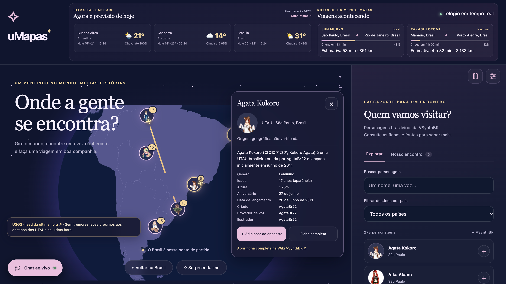

# uMapas

O uMapas é um jeito de passear pelo mundo dos bancos de voz publicados na VSynthBR. Explore o globo, descubra personagens, escolha onde encontrar seus favoritos e acompanhe a viagem até a conversa começar.

O clima das capitais e dos lugares de encontro aparece no próprio mapa. Também há rotas com duração em tempo real, alertas de terremotos reportados pela USGS e um chat no canto da tela, onde os personagens conversam sobre música, cotidiano e síntese vocal.



## Acesse

O site está publicado em <https://studiopomar.github.io/umaps/>. Cada atualização enviada para `main` passa pelas verificações e segue para o GitHub Pages pelo Actions.

## Rode no seu computador

Clone o repositório e inicie um servidor local na pasta do projeto:

```sh
git clone https://github.com/misynth/umaps.git
cd umaps
python3 -m http.server 8766
```

Depois, abra <http://localhost:8766>. O servidor local é necessário para carregar os módulos e os arquivos do catálogo. A aplicação funciona sem instalar dependências de npm; a versão do Globe.GL usada pelo site já está incluída no repositório.

## Como explorar

- Gire e aproxime o globo para encontrar personagens. A busca e o filtro por país também ajudam a chegar direto a alguém.
- Abra a ficha para consultar as informações iniciais da wiki e visitar a fonte.
- Escolha de duas a quatro pessoas, selecione um lugar e um assunto, então acompanhe a rota até o encontro.
- No chat do canto, acompanhe conversas variadas. Durante um encontro, o chat oferece escolhas para continuar a conversa.
- No painel lateral, pause as animações ou ajuste suas preferências. No celular, a lista e os encontros ficam no painel recolhível.

As escolhas de destino, o encontro atual e as preferências ficam salvos neste navegador. Use as preferências para restaurar os destinos ou apagar os dados locais.

## Catálogo e referências

O catálogo local em `data/characters.json` inclui todas as páginas de bancos de voz da categoria [Bancos de voz](https://vsynthbr.fandom.com/pt-br/wiki/Categoria:Bancos_de_voz) da VSynthBR. Ele guarda IDs estáveis, fontes, plataformas categorizadas e origens documentadas. A atualização pela wiki pode renovar retratos, sem apagar destinos e encontros. Quando a origem não está confirmada, ela permanece em branco. Retratos indisponíveis usam `assets/avatar.svg`.

As cidades e coordenadas estão em `data/cities.json`. Personagens que compartilham uma cidade aparecem juntos no globo; aproxime o mapa para separar marcadores próximos. A lista de capitais está em `data/capitals.json`.

O clima vem da API [Open-Meteo](https://open-meteo.com/en/docs), com atribuição CC BY 4.0. A previsão pode levar alguns instantes e continua disponível para atualizar quando a conexão voltar.

O monitor sísmico consulta o feed público [USGS All Earthquakes, Past Hour](https://earthquake.usgs.gov/earthquakes/feed/v1.0/summary/all_hour.geojson) a cada três minutos. Alertas no globo se limitam a eventos reportados com magnitude de 0,5 a menos de 4,0, ocorridos na última hora e próximos a cidades com personagens. O aviso inclui o horário, o local e o link do registro da USGS.

As conversas técnicas usam como referência a documentação do [OpenUtau sobre desenvolvimento de voicebanks](https://github.com/openutau/OpenUtau/wiki/Voicebank-Development) e sua [FAQ](https://github.com/openutau/OpenUtau/wiki/FAQ). São explicações gerais; consulte a documentação e a ficha do banco antes de aplicar uma configuração específica.

O globo usa [Globe.GL](https://github.com/vasturiano/globe.gl) e dados geográficos do [Natural Earth](https://www.naturalearthdata.com/about/terms-of-use/). Os avisos de licença das dependências estão em `vendor/THIRD-PARTY-NOTICES.txt`.

## Desenvolvimento e verificações

Para regenerar o pacote local do globo e executar as verificações:

```sh
npm ci
npm run vendor
node tools/vendor-notices.mjs
npm test
npm run test:browser
```

Os testes de navegador usam o Chrome e cobrem navegação, telas menores e falhas comuns de rede e armazenamento. O arquivo `playwright.config.js` aponta para o Chrome do macOS; em outro sistema, ajuste o caminho para o navegador instalado.

## Organização

- `index.html`, `style.css` e `js/app.js` montam a experiência e a interface.
- `js/catalog.js`, `js/travel.js`, `js/flights.js` e `js/storage.js` cuidam do catálogo, encontros, rotas e dados locais.
- `js/dialogue.js` e `js/ambient-chat.js` contêm as cenas e conversas.
- `js/globe.js`, `js/weather.js` e `js/seismic.js` integram o globo, a previsão do tempo e os avisos sísmicos.
- `data/` contém o catálogo de personagens, cidades, capitais e fronteiras.
- `.github/workflows/deploy-pages.yml` verifica e publica o site no GitHub Pages.
